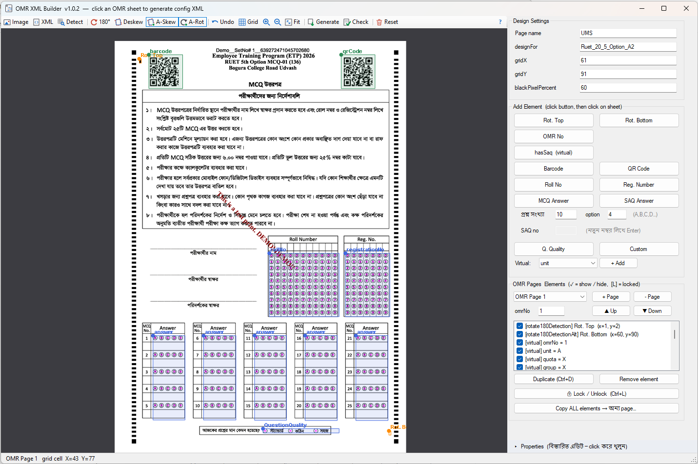
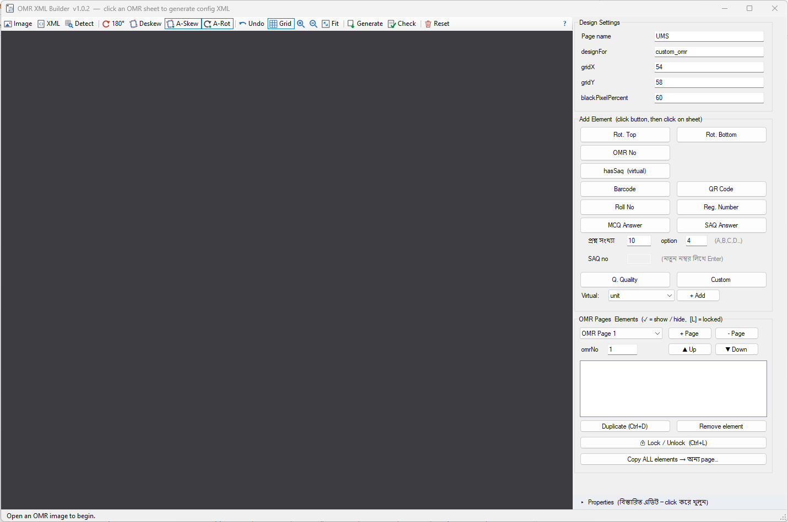

# OMR XML Builder

A Windows desktop tool for visually designing **OMR sheet configuration XML**. Open a scanned OMR sheet, click to place elements (MCQ blocks, roll number, barcode, rotation markers, …) on the detected grid, and generate a config XML that [DynamicOmrFiller](https://github.com/ronedata/DynamicOmrFiller) can read back unchanged.

> বাংলা: OMR sheet-এর ছবি খুলে click করে element বসিয়ে config XML তৈরি করার Windows tool।

## Screenshots





## Quick start

1. **Image** - open the scanned OMR sheet (the grid is detected automatically).
2. Fill in **Design Settings** (page name, designFor, gridX / gridY, blackPixelPercent).
3. Click an element button on the right (e.g. *MCQ Answer*), then click the sheet where it belongs.
4. Drag / resize / nudge until the overlay matches the sheet; use **Check** to test reading.
5. **Generate** - copy or save the config XML.

## Toolbar reference

| Button | What it does |
|---|---|
| **Image** | Open one or more OMR sheet images; each becomes its own page (double-click an empty canvas also works). |
| **XML** | Open an existing config XML in the designer for editing. |
| **Detect** | Re-detect the grid from corner markers / timing marks. |
| **180°** | Turn the active sheet upside down; grid and mapping stay unchanged (press again to undo). |
| **Deskew** | Straighten a slanted scan by measuring the corner markers, then re-detect the grid. |
| **A-Skew** | Toggle: automatically fix skew whenever an image is opened. |
| **A-Rot** | Toggle: place elements from whichever rotation marker (Top / Bottom) has ink. |
| **Undo** | Undo the last change (move, resize, add, remove, property edit), Ctrl+Z. |
| **Grid** | Show or hide the red detected-grid lines. |
| **Zoom in / out** | Zoom the selected sheet(s); the mouse wheel works too, Ctrl+click selects several. |
| **Fit** | Fit all sheets into the window. |
| **Generate** | Build the config XML from the current layout to view, copy or save. |
| **Check** | Open the current image + XML in the reader and show what is detected (magenta = reading area, green = marked). |
| **Reset** | Clear all images, pages and elements and start a new project (asks first). |
| **?** | About and a list of mouse / keyboard tips. |

## Shortcuts

`Ctrl+Z` undo · `Ctrl+D` duplicate · `Ctrl+L` lock / unlock · arrow keys nudge 0.1 cell (`Shift` = 0.5) · double-click an element to flip direction x/y · wheel to zoom.
## Features

**Designer**
- Open one or more OMR images; multi-image canvas with grid layout
- Automatic grid detection from timing marks / corner markers (DPI-independent)
- Click-to-place elements: Rotation Top/Bottom, OMR No, hasSaq, Barcode, QR Code, Roll No, Reg. Number, MCQ Answer, SAQ Answer, Question Quality, Custom, Virtual
- Drag to move, handles to resize, arrow-key nudge, double-click to flip direction
- Element lock (Ctrl+L), hide/unhide, reorder (order = XML output order)

**Editing**
- Multi-select move / nudge / remove, Undo (Ctrl+Z, last 100 steps), Reset
- Duplicate with SAQ renumbering, copy all elements between pages
- PropertyGrid for fine-grained attribute editing

**Scan handling**
- Deskew and Auto Skew for slanted scans
- Rotate 180° view and Auto Rotate based on rotation markers
- Negative `y` support for barcode / QR above the grid

**XML**
- Generate XML (copy / save) in the reference config's canonical order
- Open existing config XML back into the designer for editing

**Check OMR** — a built-in window to test a configuration against a sheet.

## Download

Prebuilt executables are in [`releases/`](releases/) (e.g. `OmrXmlBuilder_v1.0.2.exe`). Keep `zxing.dll` next to the exe.

## Build from source

Requirements: Windows, Visual Studio or MSBuild with the **.NET Framework 4.8** targeting pack.

```powershell
msbuild OmrXmlBuilder.sln /p:Configuration=Release
```

A Release build bumps the patch version automatically when source files changed and stores the exe as `releases/OmrXmlBuilder_v{version}.exe`. For a minor/major bump:

```powershell
powershell -File tools\BumpVersion.ps1 -Part minor
```

## Project layout

| File | Purpose |
|---|---|
| `MainForm.cs` | Designer UI |
| `GridDetector.cs` | Timing-mark / corner grid detection |
| `OmrReader.cs`, `CheckOmrForm.cs` | Reading and checking a sheet against a config |
| `XmlConfigBuilder.cs`, `ConfigReader.cs` | Write / read config XML |
| `Models.cs` | Project, page and element model |
| `libs/zxing.dll` | Barcode / QR decoding (ZXing.Net) |

See [CHANGELOG.md](CHANGELOG.md) for version history.

